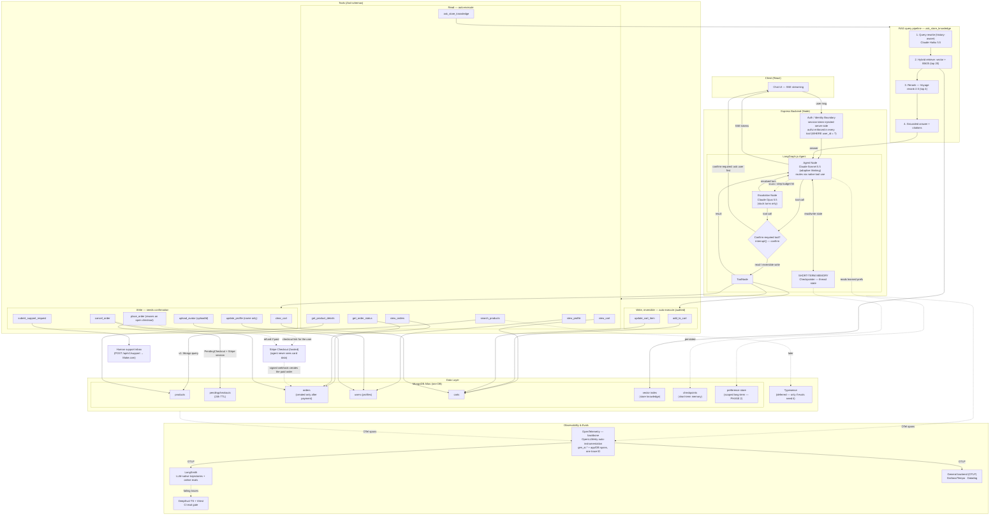
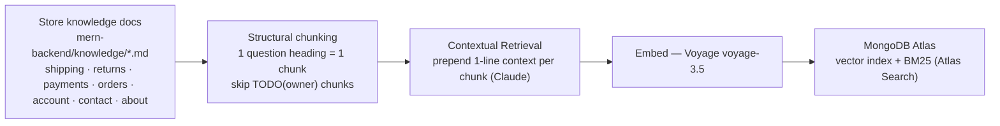

# AI Shopping Assistant — Architecture

> Agentic shopping assistant for a MERN e-commerce store. Performs actions on the user's behalf — search, cart, orders, profile — **except** entering payment card details or login credentials (card entry stays on Stripe's hosted checkout page). Interview project: every box below is defensible with reasoning + (where available) public industry corroboration.
>
> Companion docs: [`tech-stack.md`](./tech-stack.md) · [`observability.md`](./observability.md) · [`evals.md`](./evals.md) · [`security.md`](./security.md)

---

## 1. System architecture

---

## 2. RAG ingestion pipeline (offline / on doc update)

The source documents and their editing rules are in `mern-backend/knowledge/README.md` ([`reconciliation.md`](./reconciliation.md) Gap 12). They state only what the site or code already says. Unanswered policy questions are written as `TODO(owner)` and aren't indexed, so the agent falls back to the contact options instead of guessing.

---

## 3. Request flow (happy path)

1. User message hits Express → **auth boundary** attaches `user_id` + scoped session token server-side. The agent requires login in v1 — guests get a sign-in prompt instead of the chat ([`reconciliation.md`](./reconciliation.md) Gap 16).
2. **Agent (Sonnet 5.5)** reads **short-term memory** (checkpointer thread state) and picks a tool through native tool use. There is no separate intent router: one would add latency and a misrouting failure, so it's added only if evals show it beats self-routing ([`reconciliation.md`](./reconciliation.md) Gap 3). The only Haiku step is the history-aware query rewrite inside `ask_store_knowledge`.
3. The system prompt and tool definitions are identical on every request; per-request facts (cart contents, the user's name) arrive as messages or tool results. This keeps the prompt cache warm and is required on these models, which reject a history whose earlier turns, system prompt or tools changed (see [`tech-stack.md`](./tech-stack.md) Layer 3).
4. **Read tool** or **reversible cart write** (`add_to_cart`, `update_cart_item`) → auto-executes (writes are audited). **Confirm-required tool** (see §4) → `interrupt()` surfaces a summary ("3 items, $142.50, ship to Home — confirm?") and waits for explicit user yes.
5. Tool runs with **server-side authz** (`WHERE user_id = ?`), hits MongoDB (products, carts, orders, users) or Atlas Search (store knowledge).
6. Result returns to the agent → grounded response **streamed to React via SSE**.
7. On confirm, `place_order` calls the same `createCheckoutSession(userId, shippingAddress)` as the `/checkout` page. It snapshots the cart into a **`PendingCheckout`** (prices and totals computed server-side; expires after 24h) and creates a **Stripe Checkout session**. The agent returns the session's link, and the user pays on Stripe's hosted page — the agent never touches card data. **No order exists yet.** Stripe's **signed webhook** (`checkout.session.completed`) then creates the `Order` as `status: 'pending'`, `paymentStatus: 'paid'`, keyed on the Stripe session id so a redelivered event can't create a second order. An abandoned checkout leaves no order behind; its `PendingCheckout` simply expires. This is payment-first, the flow the site already uses ([`reconciliation.md`](./reconciliation.md) Gap 1).
8. **Escalation:** if the agent is stuck — loop detection (same tool + args repeated), step budget exceeded, or repeated tool errors — the turn is retried once on the **Opus 5.5 escalation node** with the same tools and the same confirmation gate. Opus can't read Sonnet's earlier reasoning blocks; the API drops them unbilled and Opus re-plans the turn from the visible history. If Opus can't resolve it either, the agent offers `submit_support_request` (human handoff).
9. Every step emits **OpenTelemetry** spans (via OpenLLMetry) correlated under one trace ID → **LangSmith** (LLM-native view) + a general OTLP backend; the whole path is gated in CI by **DeepEval**. Full detail in [`observability.md`](./observability.md).

---

## 4. Tool catalog (single source of truth)

**Confirmation rule:** a tool needs `interrupt()` confirmation if it is **irreversible, bulk, account-changing, or external-facing**. Reversible single-item cart edits auto-execute (no money moves; the user can undo in one step) but are still audit-logged.

| Tool                                       | Type                | Confirm? | Notes                                                                                                                                                                                                                                                                                                                                                                                                                                                                                                                                                                                                                                                                                                                                                                                                                                                                                                                                                              |
| ------------------------------------------ | ------------------- | -------- | ------------------------------------------------------------------------------------------------------------------------------------------------------------------------------------------------------------------------------------------------------------------------------------------------------------------------------------------------------------------------------------------------------------------------------------------------------------------------------------------------------------------------------------------------------------------------------------------------------------------------------------------------------------------------------------------------------------------------------------------------------------------------------------------------------------------------------------------------------------------------------------------------------------------------------------------------------------------ |
| `search_products`                          | read                | no       | v1 wraps the existing Mongo product query (`getAllProductsService`), validated by one zod query schema shared with the REST route (which also fixes follow-ups §6); keyword + filters (price range, brands, categories, in-stock); sort `newest`, `price_asc` or `price_desc` — mirrors `/products`, which has no in-stock filter yet. Typesense, and a `relevance` sort with it, come only if evals show Mongo search isn't good enough ([`reconciliation.md`](./reconciliation.md) Gap 8)                                                                                                                                                                                                                                                                                                                                                                                                                                                                        |
| `get_product_details(productId)`           | read                | no       | Mongo `products`: name, description, price, stock, images, category, brand; related products = same category — mirrors `/products/:id`. Description returned inside an untrusted-content block. v1 has no materials/specs, ratings, reviews or sale price ([`reconciliation.md`](./reconciliation.md) Gap 7)                                                                                                                                                                                                                                                                                                                                                                                                                                                                                                                                                                                                                                                       |
| `ask_store_knowledge`                      | read                | no       | RAG over `mern-backend/knowledge/` (shipping, returns, payments, orders, account, contact & support, about) — see §2                                                                                                                                                                                                                                                                                                                                                                                                                                                                                                                                                                                                                                                                                                                                                                                                                                               |
| `view_cart`                                | read                | no       | totals computed server-side                                                                                                                                                                                                                                                                                                                                                                                                                                                                                                                                                                                                                                                                                                                                                                                                                                                                                                                                        |
| `view_orders`                              | read                | no       | optional `status` filter (`pending`, `processing`, `shipped`, `delivered`, `cancelled`); wraps `getMyOrders(ctx.userId)`                                                                                                                                                                                                                                                                                                                                                                                                                                                                                                                                                                                                                                                                                                                                                                                                                                           |
| `get_order_status(orderId)`                | read                | no       | ownership check `{ _id: orderId, user: ctx.userId }` — another user's ID returns nothing, the same "not found" as a nonexistent one                                                                                                                                                                                                                                                                                                                                                                                                                                                                                                                                                                                                                                                                                                                                                                                                                                |
| `view_profile`                             | read                | no       | PII minimized in output                                                                                                                                                                                                                                                                                                                                                                                                                                                                                                                                                                                                                                                                                                                                                                                                                                                                                                                                            |
| `add_to_cart(productId, quantity)`         | write, reversible   | no       | qty 1–99, bounded by stock                                                                                                                                                                                                                                                                                                                                                                                                                                                                                                                                                                                                                                                                                                                                                                                                                                                                                                                                         |
| `update_cart_item(productId, quantity)`    | write, reversible   | no       | `quantity: 0` removes the item                                                                                                                                                                                                                                                                                                                                                                                                                                                                                                                                                                                                                                                                                                                                                                                                                                                                                                                                     |
| `clear_cart`                               | write, bulk         | **yes**  |                                                                                                                                                                                                                                                                                                                                                                                                                                                                                                                                                                                                                                                                                                                                                                                                                                                                                                                                                                    |
| `place_order(shippingAddress)`             | write, irreversible | **yes**  | `shippingAddress` = the `/checkout` form fields (`fullName`, `address`, `apartment`?, `city`, `state`?, `postalCode`, `country`, `phone`?; `?` = optional), validated server-side with the **same Zod schema as the checkout form**. Agent pre-fills from the user's most recent order; the confirmation summary shows the items, the server-computed total and the full address. Wraps `createCheckoutSession(ctx.userId, shippingAddress)`: creates a `PendingCheckout` + Stripe session and returns the Stripe Checkout link; the signed webhook creates the paid `Order`. **Duplicate guard:** if an unexpired `PendingCheckout` already exists for the same `{ user, cartHash }` (`cartHash` = sorted `productId:qty` + address hash), its link is returned instead of a new session. The guard is server-derived; there is no idempotency argument in the schema ([`reconciliation.md`](./reconciliation.md) Gap 5). Stripe-only in v1 — no cash on delivery |
| `cancel_order(orderId)`                    | write, irreversible | **yes**  | **new capability** (roadmap step 3), added to the agent and as a `/dashboard` button through one `cancelOrder(userId, orderId)` service. Only while `pending` / `processing`; ownership and state checked in one atomic query. If the order was `paid`, the server refunds it through Stripe (agent never touches it) and sets `paymentStatus: 'refunded'`                                                                                                                                                                                                                                                                                                                                                                                                                                                                                                                                                                                                         |
| `update_profile(name)`                     | write, account      | **yes**  | **name only** — no password or email field in the schema; credential/identity changes stay in the UI: Edit Profile's Change Password and Change Email sections, or forgot-password ([`reconciliation.md`](./reconciliation.md) Gap 10)                                                                                                                                                                                                                                                                                                                                                                                                                                                                                                                                                                                                                                                                                                                             |
| `upload_avatar(uploadId)`                  | write, account      | **yes**  | the chat UI posts the image to `POST /uploads/avatar` (one JPEG/PNG/GIF/WEBP of up to 2 MB), which stores it as a `PendingUpload` owned by the user and returns an opaque `uploadId`; the tool applies it via `applyAvatarUpload(ctx.userId, uploadId)`. The agent never sees file bytes. Built with the chat UI, M3 ([`reconciliation.md`](./reconciliation.md) Gap 11)                                                                                                                                                                                                                                                                                                                                                                                                                                                                                                                                                                                           |
| `submit_support_request(subject, message)` | write, external     | **yes**  | name/email injected from the session, not the LLM. Calls the same `submitSupportRequest` service as the `/contact` form (`POST /api/v1/support` → Make.com → support inbox). This is the human-escalation path                                                                                                                                                                                                                                                                                                                                                                                                                                                                                                                                                                                                                                                                                                                                                     |

`userId` appears in **no** tool schema — it is bound server-side (see [`security.md`](./security.md) §3).

**Order state model** — two fields on the `Order` model (`order.model.ts`; values are lowercase, and the owner field is `user`):

| Field                                            | Values                                                                                                                                                                                                                               | Set by                                                                                                                                        |
| ------------------------------------------------ | ------------------------------------------------------------------------------------------------------------------------------------------------------------------------------------------------------------------------------------ | --------------------------------------------------------------------------------------------------------------------------------------------- |
| `status` (fulfillment — what `/dashboard` shows) | `pending` → `processing` → `shipped` → `delivered`, or `cancelled`                                                                                                                                                                   | the webhook creates the order as `pending`; staff move it on in the admin panel; `cancel_order` (or the `/dashboard` button) sets `cancelled` |
| `paymentStatus`                                  | `paid` on every order, because an order is created only once Stripe confirms payment; `refunded` after a cancellation refund (added in roadmap step 3). `pending` and `failed` exist in the enum but the Stripe flow never sets them | the Stripe webhook / the server-side refund only — **never the agent**                                                                        |

Before payment, a checkout is a `PendingCheckout`, not an order: there are no unpaid orders. The `paymentMethod` enum also lists `cod`, but no cash-on-delivery flow exists, and the agent is Stripe-only in v1.

**Feature parity with the site** ([`customer-actions.md`](./customer-actions.md) §1–§7, the UI as built): every customer action maps to a tool, except UI-only interactions (image gallery, mobile filter dialog), account access (sign-up, sign-in, email verification) and credential changes (password, email), which deliberately stay in the UI: Edit Profile's Change Password and Change Email, and forgot-password ([`reconciliation.md`](./reconciliation.md) Gap 10). Order cancellation is new to both: it ships in the agent and on `/dashboard` together.

---

## 5. Memory model

| Layer                      | Primitive                                      | Scope            | Status           | Why                                                                                                                           |
| -------------------------- | ---------------------------------------------- | ---------------- | ---------------- | ----------------------------------------------------------------------------------------------------------------------------- |
| **Short-term**             | LangGraph **Checkpointer** (Mongo)             | one conversation | **✅ shipped**   | Reference resolution: "add _the blue one_", "make it _2_", "_yes_ confirm". Agent is amnesiac without it.                     |
| **Long-term (structured)** | Mongo collections + **tools**                  | across sessions  | **✅ via tools** | Orders / profile / cart are authoritative data — queried with `view_orders` etc., **never** paraphrased from LLM memory.      |
| **Long-term (inferred)**   | LangGraph **Store** keyed by `user_id` (Mongo) | across sessions  | **🟡 phase 2**   | Personalization — learned prefs ("prefers eco brands") not captured as DB fields. Bounded, with privacy + poisoning controls. |

**Boundary rule:** authoritative data lives in the DB behind tools; only _inferred_ signals go in long-term memory. Structured data ≠ memory.

---

## 6. "Defend every box" cheat sheet

| Component           | Choice                                                           | Why this / why not the alternative                                                                                                                                                                                                                                                                  | Public corroboration                                                   |
| ------------------- | ---------------------------------------------------------------- | --------------------------------------------------------------------------------------------------------------------------------------------------------------------------------------------------------------------------------------------------------------------------------------------------- | ---------------------------------------------------------------------- |
| Orchestration       | **LangGraph.js**                                                 | Single agent + tools; `interrupt()` HITL; Mongo checkpointer. Not multi-agent — no confusion at this scope.                                                                                                                                                                                         | Shopify Sidekick = "relatively simple agent: LLM + tools"              |
| Agent model         | **Claude Sonnet 5.5** (`claude-sonnet-5-5`)                      | Best tool-use/cost balance ($2/$10 per MTok); 1M ctx; adaptive thinking with an explicit effort level. Opus as the default = overkill cost (used only for escalation); Haiku = too weak for multi-step. M7 evals also compare a single Opus 5.5 at lower effort against this cascade.               | Rufus runs on Claude Sonnet via Bedrock                                |
| Query-rewrite model | **Claude Haiku 5.5** (`claude-haiku-5-5`)                        | Cheap history-aware rewrite for knowledge retrieval only. A separate intent router is deferred until evals show it beats self-routing ([`reconciliation.md`](./reconciliation.md) Gap 3).                                                                                                           | Rufus has a query-planning/classification layer                        |
| Escalation model    | **Claude Opus 5.5** (`claude-opus-5-5`)                          | Only on stuck turns (loop, step budget, repeated tool error) — bounded cost, higher success on the hard tail. Same tools + same confirmation gate, so no extra privilege. Not a second agent.                                                                                                       | —                                                                      |
| Product search      | **MongoDB query in v1; Typesense if evals need it**              | Search problem, not RAG — need exact filters (price ≤ 50, in-stock). Vectors can't guarantee "under $50". The catalog is small, so the existing Mongo filters cover v1; Typesense (typo tolerance, relevance ranking) is added only if search evals fail.                                           | —                                                                      |
| Knowledge retrieval | **Hybrid (vector + BM25)**                                       | Policy text is keyword-heavy ("refund", "30 days"); pure vector misses exact terms, pure BM25 misses paraphrase.                                                                                                                                                                                    | Shopify: "hybrid retrieval — lexical + semantic"                       |
| Chunking            | **Structural (1 logical unit/chunk)** + Contextual Retrieval     | Docs are pre-structured; fixed-size splits policies mid-sentence.                                                                                                                                                                                                                                   | Undisclosed → data-driven + Anthropic Contextual Retrieval             |
| Reranking           | **Voyage rerank-2.5**                                            | Cheap precision bump; wrong policy answer = false promise.                                                                                                                                                                                                                                          | Undisclosed → RAG research + proven by DeepEval `contextual_precision` |
| Embeddings          | **Voyage voyage-3.5**                                            | Claude-native recommendation; strong + cheap.                                                                                                                                                                                                                                                       | —                                                                      |
| Vector store        | **MongoDB Atlas Vector**                                         | Reuse existing DB — one datastore, not a new Pinecone/Qdrant.                                                                                                                                                                                                                                       | —                                                                      |
| Short-term memory   | **Checkpointer**                                                 | Multi-turn reference resolution.                                                                                                                                                                                                                                                                    | standard agent practice                                                |
| Write safety        | **`interrupt()` + checkout reuse**                               | Confirm irreversible / bulk / account / external actions; reversible cart edits auto-execute to avoid confirmation fatigue. No double checkouts: an open `PendingCheckout` for the same cart + address is reused, and the webhook is idempotent on the Stripe session id, so no double orders.      | —                                                                      |
| Payment             | **Payment-first: `PendingCheckout` + Stripe Checkout + webhook** | The same path as the site's `/checkout`, so UI and agent can't drift. The `PendingCheckout` (24h TTL) is the trackable pre-order; the `Order` exists only once Stripe confirms payment, so there are no abandoned unpaid orders; payment state comes only from the signed webhook, never the agent. | —                                                                      |
| Auth                | **server-side token + per-tool authz**                           | LLM can be jailbroken; authz enforced in DB, never in prompt. Payment/login/password stay out of the agent.                                                                                                                                                                                         | —                                                                      |
| Tracing backbone    | **OpenTelemetry** (+ OpenLLMetry)                                | Vendor-neutral `gen_ai.*` spans; correlates LLM + Mongo + HTTP in one trace; no lock-in. OpenLLMetry = OTel auto-instrumentation, not a competitor.                                                                                                                                                 | OTel GenAI semantic conventions                                        |
| Observability       | **LangSmith**                                                    | LLM-native trajectory view + online evals; ingests OTLP.                                                                                                                                                                                                                                            | —                                                                      |
| Evals               | **DeepEval-TS + Vitest**                                         | Named metrics (faithfulness, contextual precision/recall, tool-correctness) as CI gate. Beta — fallback LangSmith evals.                                                                                                                                                                            | industry: LLM-judge evals (Shopify)                                    |

---

## 7. What I deliberately did NOT use (and why)

- **Multi-agent** — single agent + tools is enough at this scope; Shopify runs 100M+ convos this way. (Opus escalation is a model swap for one turn, not a second agent.)
- **A separate intent router** — the agent model routes through native tool use; a Haiku router would add a hop and a misrouting failure, so it waits for evidence from evals ([`reconciliation.md`](./reconciliation.md) Gap 3).
- **GraphRAG** — no entity graph to traverse in a flat FAQ/policy KB.
- **HyDE / Self-RAG / CRAG** — extra latency for marginal gain once I have query-rewrite + hybrid + rerank; would revisit only if eval hallucination rate demanded it.
- **Separate vector DB** — Atlas keeps it one datastore.
- **LLM long-term memory for orders/profile** — that's authoritative structured data, accessed via tools.
- **Fine-tuning** — knowledge stays in retrieval so policies update without retraining.

---

## 8. Interview soundbites

1. "Product discovery is faceted search, not RAG — I only RAG the unstructured knowledge base."
2. "Single agent + tools, matching Shopify's published pattern — I rejected multi-agent as over-engineering."
3. "I chose each RAG technique from my data's characteristics; it converges with Shopify's hybrid retrieval. Where industry is silent (reranking, chunking), I justified from research and let DeepEval be the judge."
4. "Anything irreversible, bulk, account-changing, or external goes through an `interrupt()` confirmation; reversible cart edits don't, so users aren't nagged. The LLM proposes, the backend disposes."
5. "Authoritative data stays in Mongo behind tools — never in LLM memory. Short-term memory is only for in-conversation reference resolution."

---

_Sources: [Amazon Rufus — IEEE Spectrum](https://spectrum.ieee.org/amazon-rufus) · [Shopify Sidekick — ZenML LLMOps](https://www.zenml.io/llmops-database/building-and-evaluating-sidekick-a-production-agent-for-e-commerce-merchants) · [Anthropic Contextual Retrieval](https://www.anthropic.com/news/contextual-retrieval)_
