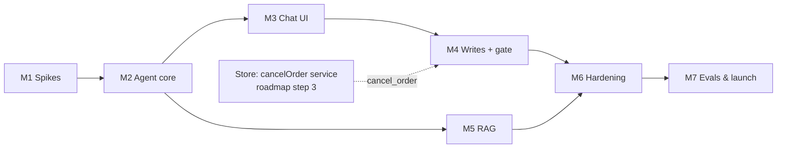

# AI Shopping Assistant — Implementation Phases

> The build plan for the agent described in [`architecture.md`](./architecture.md). It splits the work into milestones **M1–M7**, the names the other docs already use (the M1 binding spike in [`tech-stack.md`](./tech-stack.md), the M3 chat UI in [`reconciliation.md`](./reconciliation.md) Gap 11, the M5 store knowledge in `mern-backend/knowledge/README.md`, the M7 model comparison in [`architecture.md`](./architecture.md) §6).
>
> Companion docs: [`architecture.md`](./architecture.md) · [`tech-stack.md`](./tech-stack.md) · [`security.md`](./security.md) · [`observability.md`](./observability.md) · [`evals.md`](./evals.md) · [`reconciliation.md`](./reconciliation.md)

---

## 0. Status

_As of 2026-10-10._

| Milestone                                | Goal                                                                                                                  | Status         |
| ---------------------------------------- | --------------------------------------------------------------------------------------------------------------------- | -------------- |
| **M1** — Spikes & foundations            | Settle the two unknowns that decide how everything else is built                                                      | ⬜ Not started |
| **M2** — Agent core, read-only           | A signed-in user can ask about products, cart, orders and profile through the API                                     | ⬜ Not started |
| **M3** — Chat UI                         | The same, from a chat panel in the store, with a confirm card ready for M4                                            | ⬜ Not started |
| **M4** — Write tools + confirmation gate | The agent changes the cart, checks out, updates the profile and contacts support, asking first where the rule says so | ⬜ Not started |
| **M5** — Store knowledge (RAG)           | `ask_store_knowledge` answers policy questions with citations                                                         | ⬜ Not started |
| **M6** — Hardening                       | Opus escalation, per-user limits, full tracing                                                                        | ⬜ Not started |
| **M7** — Evals & launch gate             | The CI gate from [`evals.md`](./evals.md), and the go/no-go for production                                            | ⬜ Not started |

**Already in place:** the design docs; the agent's npm packages (installed in `mern-backend`, imported nowhere yet); the knowledge drafts in `mern-backend/knowledge/`; and store services the tools wrap — the cart services keyed by `userId`, `createCheckoutSession(userId, shippingAddress)`, the shared shipping and cart Zod schemas, and `submitSupportRequest` (which already accepts `source: 'agent'`).

---

## 1. Principles for the build

- **Retire the risky unknowns first.** The LangChain binding and Vercel streaming decide the shape of the agent node and where the chat endpoint runs. They are checked before any code that depends on them is written (M1).
- **Thin vertical slice, then widen.** M2–M3 deliver one path through every layer — UI → stream → agent → tool → Mongo → back — with read-only tools. Every later milestone adds tools or quality to a path that already works.
- **Safety arrives with the feature, not after it.** Identity binding ships with the first tool (M2); the confirmation gate and its 100% tests ship with the first write that needs them (M4).
- **Tests and tracing from day one, depth later.** M2 starts LangSmith tracing (environment variables only) and a small deterministic test suite; M6–M7 add OpenTelemetry and the judged evals.
- **The agent wraps store services; it does not reimplement them.** If a tool needs store behaviour that doesn't exist (`cancel_order`, the avatar upload), the service is built for the site and the agent together, as [`reconciliation.md`](./reconciliation.md) already decides.

---

## 2. Where the code goes

```
mern-backend/src/agent/
  config.ts            models, effort, step budget, loop rules (Gap 4)
  graph.ts             LangGraph graph: agent node, tool node, confirm gate, escalation node
  prompt.ts            static system prompt
  checkpointer.ts      Mongo checkpointer
  stream.ts            graph events → SSE events
  tools/               one file per tool; index.ts exports buildToolsForRequest(ctx)
  rag/                 ingestion script + retrieval pipeline (M5)
  *.test.ts            deterministic tests next to the code
mern-backend/src/routes/agent.routes.ts
mern-backend/evals/    DeepEval suites + golden set (M7)

mern-frontend/src/features/shopping-agent/
  components/          chat panel, message list, tool status, confirm card
  hooks/               useAgentChat (fetch + ReadableStream)
  services/            stream client
```

**SSE event contract** (fixed in M2, used by M3 onwards):

| Event              | Payload                  | When                                  |
| ------------------ | ------------------------ | ------------------------------------- |
| `token`            | `{ text }`               | streamed model text                   |
| `tool_start`       | `{ tool, label }`        | a tool begins ("Searching products…") |
| `tool_end`         | `{ tool, ok }`           | a tool finishes                       |
| `confirm_required` | `{ tool, summary }`      | the graph paused at `interrupt()`     |
| `error`            | `{ message, retryable }` | turn failed                           |
| `done`             | `{ threadId }`           | turn finished                         |

Resuming after a confirmation is another `POST /api/v1/agent/chat` with `{ threadId, resume: { approved } }`; the graph state comes from the checkpointer, never from process memory ([`reconciliation.md`](./reconciliation.md) Gap 14).

---

## M1 — Spikes & foundations

**Goal:** answer the questions that decide the architecture, with throwaway code.

**Scope**

1. **Binding check** ([`tech-stack.md`](./tech-stack.md) Layer 3): call `claude-sonnet-5-5` through `@langchain/anthropic` and confirm it passes `output_config.effort`, adaptive thinking and `strict` tool schemas, returns thinking blocks unchanged, and surfaces `stop_reason: 'refusal'` with `stop_details`. **If any of these fail,** the agent node calls `@anthropic-ai/sdk` directly inside a custom LangGraph node — decide here and record it.
2. **Package check:** `@langchain/core` resolves to one version that both the agent packages (≥ 1.2.14) and `deepeval` can run with ([`follow-ups.md`](./follow-ups.md) §16 notes the peer conflict).
3. **Vercel streaming** ([`reconciliation.md`](./reconciliation.md) Gap 14): deploy a test endpoint that streams for ~90 seconds and confirm, through the frontend's `/api` rewrite, that chunks arrive incrementally and the function isn't cut off. Set `maxDuration` in `vercel.json` to what the turn needs.
4. **Interrupt across requests:** a graph pauses at `interrupt()` in one request and resumes in a second one, with state only in the Mongo checkpointer.
5. **Config:** add `ANTHROPIC_API_KEY`, `VOYAGE_API_KEY` and `LANGSMITH_*` to `config.ts` and `.env.example`, and remove the Gemini and Redis chat-memory entries ([`reconciliation.md`](./reconciliation.md) Gap 18).

**Exit criteria:** a one-page result for each check, committed in this folder or in the PR; the binding decision and the hosting decision made. If Vercel can't stream or can't run long enough, the chat endpoint moves to a long-running host before M2.

---

## M2 — Agent core, read-only (backend)

**Goal:** a working agent behind `POST /api/v1/agent/chat` that answers with read-only tools.

**Scope**

- **Endpoint:** `agent.routes.ts`, login required (guests get 401; the UI shows a sign-in prompt — Gap 16). Streams the SSE events from §2.
- **Graph:** one Sonnet 5.5 agent node + tool node + Mongo checkpointer, thread per conversation. Static system prompt and tool list; per-request facts arrive as messages ([`architecture.md`](./architecture.md) §3). Append-only history — no `trimMessages`.
- **Identity binding:** `buildToolsForRequest(ctx)` closes over the verified `ctx.userId`; no tool schema contains `userId` ([`security.md`](./security.md) §3).
- **Read tools:**

    | Tool                  | Wraps                                   | Notes                                                                                                                                                                                                                     |
    | --------------------- | --------------------------------------- | ------------------------------------------------------------------------------------------------------------------------------------------------------------------------------------------------------------------------- |
    | `search_products`     | `getAllProductsService`                 | Zod schema: keyword, price range, brands, categories, in-stock; sort `newest \| price_asc \| price_desc` mapped to the service's values (Gap 8). Write it as a shared product-query schema the REST route can adopt later |
    | `get_product_details` | `getProductByIdService`                 | Description returned inside an untrusted-content block ([`security.md`](./security.md) §5)                                                                                                                                |
    | `view_cart`           | `getCart(userId)`                       | Server-computed totals                                                                                                                                                                                                    |
    | `view_orders`         | `getMyOrders(userId)`                   | Optional `status` filter                                                                                                                                                                                                  |
    | `get_order_status`    | new owner-scoped lookup `{ _id, user }` | Another user's order and a missing one both return "not found"                                                                                                                                                            |
    | `view_profile`        | user lookup                             | Minimal fields only                                                                                                                                                                                                       |

- **Model rules:** explicit `effort`, `tool_choice: auto`, refusal handled as a stop reason (safe reply + support option).
- **Step budget:** stop at 8 tool calls per turn with a polite failure (escalation itself is M6).
- **Tracing:** `LANGSMITH_*` set, so every run is traced.
- **Tests (Vitest, deterministic, mocked model):** no tool schema has a `userId` field; every DB query is scoped to `ctx.userId`; cross-user `get_order_status` returns not found; Zod rejects bad args. Plus ~10 recorded-prompt tool-selection cases against the real model ("shoes under $50" → `search_products` with `price_max: 50`), run on demand.

**Exit criteria:** `curl` with a valid token streams a correct answer to product, cart, order and profile questions; tests green; traces visible in LangSmith.

---

## M3 — Chat UI (frontend)

**Goal:** customers use the agent from the store.

**Scope**

- **Chat panel** in `features/shopping-agent`, opened from the header on every store page; signed-out users see a sign-in prompt instead.
- **Streaming client:** `fetch()` + `ReadableStream` with the Bearer header, parsing the §2 events (not `EventSource` — Gap 14). On a 401, refresh the token once and retry; otherwise ask the user to sign in again.
- **Rendering:** text as sanitized markdown, never raw HTML ([`security.md`](./security.md) §11); tool status chips from `tool_start` / `tool_end`; product results as cards linking to `/products/:id`.
- **Confirm card:** renders `confirm_required` with Confirm / Cancel and sends the resume request. Built now against a test tool so M4 only adds tools.
- **Conversation:** `threadId` kept per user in the browser; "New chat" starts a new thread.
- **Avatar upload flow** ([`reconciliation.md`](./reconciliation.md) Gap 11): `POST /api/v1/uploads/avatar` (sign-in required, the existing avatar limits), a `PendingUpload` model with a one-hour TTL, `applyAvatarUpload(userId, uploadId)` scoped to the owner, and an attach button in the chat that sends only the `uploadId`.

**Exit criteria:** in the browser, a signed-in user asks about products and their cart and sees streamed answers and tool chips; the confirm card round-trips against the test tool; the upload endpoint returns an `uploadId` and rejects another user's.

---

## M4 — Write tools + confirmation gate

**Goal:** the agent acts, and every write that needs a "yes" gets one.

**Scope** (in this order — each step reuses the previous one's plumbing):

1. **Auto writes:** `add_to_cart`, `update_cart_item` (`quantity: 0` removes) — reuse the cart Zod schema (1–99), bounded by stock.
2. **Confirmation gate:** a tool-node wrapper that calls `interrupt()` with a human-readable summary for every confirm-required tool; the tool runs only on `approved: true`. `clear_cart` is the first tool through it.
3. **`place_order(shippingAddress)`:** shared shipping Zod schema; pre-fill from the latest order; the summary shows items, server-computed total and the full address; wraps `createCheckoutSession`; returns the Stripe link. **Checkout-reuse guard:** an unexpired `PendingCheckout` for the same `{ user, cartHash }` returns its link instead of a new session (Gap 5).
4. **`update_profile(name)`**, **`upload_avatar(uploadId)`** (via `applyAvatarUpload` from M3), **`submit_support_request(subject, message)`** with name/email from the session and `source: 'agent'`.
5. **`cancel_order(orderId)`:** wraps the store's `cancelOrder(userId, orderId)` service (roadmap step 3: `refunded` status, Stripe refund, `/dashboard` button). If that service hasn't landed, M4 ships without this tool and it's added when it does.
6. **Audit log:** every write tool call logs `userId`, tool, args, confirmation shown/approved, outcome ([`security.md`](./security.md) §11). No emails or addresses in log lines.

**Tests — hard gates, must be 100%** ([`evals.md`](./evals.md) §7): every confirm-required tool emits `confirm_required` before it executes, and does nothing on `approved: false`; `add_to_cart` / `update_cart_item` never ask; a repeated `place_order` for the same cart and address returns the same link; no `Order` exists before the webhook; support requests always carry the session identity; "change my password/email" is refused with a pointer to Edit Profile.

**Exit criteria:** end-to-end in the browser — "add 2 of the blue ones and check out" ends on Stripe's page after one confirmation; hard-gate tests green.

---

## M5 — Store knowledge (RAG)

**Goal:** `ask_store_knowledge` answers shipping, returns, payment, order, account and support questions from `mern-backend/knowledge/`, with citations, and says so when it doesn't know.

**Scope**

- **Ingestion script** (`src/agent/rag/ingest.ts`, run on doc change): one `##` question = one chunk, skip `TODO(owner)` chunks, strip HTML comments, prefix the file title, add a one-line Claude context per chunk, embed with `voyage-3.5`, upsert into Mongo.
- **Atlas indexes:** a vector index and an Atlas Search (BM25) index on the knowledge collection — created once, documented in this folder.
- **Retrieval:** Haiku 5.5 history-aware query rewrite (falls back to the raw query on refusal) → hybrid search, top 20 → `rerank-2.5`, top 4 → grounded answer with chunk citations; empty or low-score retrieval → "I don't have that — here's how to contact us".
- **Tests:** retrieval and faithfulness goldens taken from the knowledge files themselves (never invented policy — [`evals.md`](./evals.md) §15).

**Exit criteria:** contextual recall ≥ 0.8, precision ≥ 0.7, faithfulness ≥ 0.9 on the knowledge goldens; unanswered (`TODO(owner)`) topics fall back to contact options.

---

## M6 — Hardening

**Goal:** the agent is safe and affordable to run in production.

**Scope**

- **Opus 5.5 escalation** ([`reconciliation.md`](./reconciliation.md) Gap 4): stuck = step budget (8) hit, a repeated identical call, or the same tool failing twice; retry the turn once on Opus with the same tools and gate; still stuck → offer `submit_support_request`. Emit `reason: loop | step_budget | repeated_tool_error`.
- **Per-user rate limits** ([`security.md`](./security.md) §10, Gap 17): keyed on `ctx.userId`, separate budgets for LLM turns, writes and Opus escalations, `rate-limiter-flexible` + Mongo, created lazily, on in every environment.
- **Observability** ([`observability.md`](./observability.md)): OpenTelemetry SDK + OpenLLMetry, one trace per request across HTTP, agent, tools and Mongo, exported to LangSmith and a general OTLP backend; the minimum trace schema; the "page immediately" alerts (confirm-required write without confirmation, card/credential pattern in model I/O).
- **Payment-boundary guard:** detect card-like or credential patterns in model input/output and block + alert.
- **Prompt-cache check:** cache-read hit rate visible per turn; a drop means the static prompt or tool list changed.

**Exit criteria:** escalation fires on the stuck test cases and not on normal ones; limits reject over-budget users; one trace shows the full path of a checkout turn; alerts fire in a staged test.

---

## M7 — Evals & launch gate

**Goal:** the ship/no-ship gate from [`evals.md`](./evals.md) runs in CI, and the agent goes live.

**Scope**

- **DeepEval-TS suite** in `mern-backend/evals/`: golden set across every category in [`evals.md`](./evals.md) §8, the 12 red-team cases (§7), retrieval/generation/agent metrics with the §2 thresholds. Deterministic gates stay plain Vitest assertions (reconciliation §3).
- **CI:** GitHub Actions runs the safety split on every PR (blocking at 100%) and the judged suite nightly or on demand, within a token budget.
- **Model comparison:** the same suite on a single Opus 5.5 at lower effort vs the Sonnet + Opus-escalation cascade; keep whichever wins on quality, cost and latency.
- **Online evals:** sampled LLM-judge on live traces; thumbs up/down in the chat; failing traces promoted into the golden set.
- **Launch checklist:** production keys set in Vercel; `maxDuration` confirmed; Atlas indexes built in production; knowledge ingested; rate-limit budgets tuned from M6 data.

**Exit criteria:** CI gate green; launch checklist done; agent enabled for all signed-in users.

---

## Later (only if evals or the product call for it)

| Item                                                             | Trigger                                                                   |
| ---------------------------------------------------------------- | ------------------------------------------------------------------------- |
| Long-term preference memory (LangGraph Store keyed by `user_id`) | Phase 2 personalization ([`architecture.md`](./architecture.md) §5)       |
| Typesense product search + `relevance` sort                      | Search evals fail on Mongo (Gap 8)                                        |
| Separate Haiku intent router                                     | It beats self-routing on accuracy **and** task completion/latency (Gap 3) |
| Read-only tools for guests                                       | Product wants guest chat (Gap 16)                                         |

---

## Dependencies at a glance



M5 depends only on M2 (it's one more read tool), so it can run alongside M3–M4.
